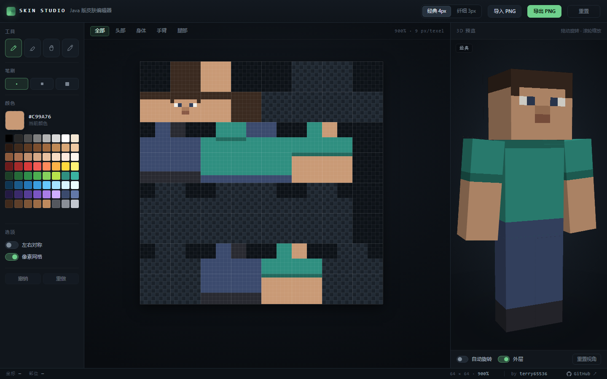

# Minecraft Skin Studio

A pixel-art skin editor for **Minecraft: Java Edition** that runs entirely in your browser — as a **single HTML file**, with no server, no build step and no dependencies.

Draw the skin on a 64 × 64 atlas, watch it in the live 3D preview, and export a PNG that drops straight into Minecraft.

## Features

- **Pixel editor** — pencil, eraser, bucket fill and colour picker, with 1/2/3 px brushes and Bresenham-interpolated strokes.
- **Layer-aware editing** — the base skin and the overlay layer (hat, jacket, sleeve, pants) are edited separately; unused atlas regions are dimmed so you never paint into dead pixels.
- **Face focus** — jump to any of the six sides of the skin, or stay in "all" mode. The status bar always tells you which body part and which face you are painting on.
- **Mirror mode** — a stroke on one side of the body is mirrored to the other (arms, legs and torso).
- **Live 3D preview** — a small WebGL renderer shows the classic and slim (Alex) models with correct per-face UVs, directional lighting and the inflated overlay layer. Drag to orbit, scroll or pinch to zoom.
- **Classic / slim models** — 4 px and 3 px arms, switchable at any time.
- **Import and export** — load any standard 64 × 64 skin; legacy 64 × 32 skins are converted on import. Export writes an exact 64 × 64 PNG.
- **Undo / redo** — 64 steps covering both layers of the atlas.
- **Autosave** — the current skin is stored in `localStorage` and restored on reload.
- **Keyboard driven** — single-key tool switching, brush sizing and undo while you paint.

## Quick start

1. Download `skin-studio.html`.
2. Open it in a desktop browser (double-click is enough — no local server required).
3. Paint, then press **Export PNG**.
4. Upload the PNG on [minecraft.net](https://www.minecraft.net/en-us/profile/skin) or through your launcher's skin settings. Third-party launchers such as HMCL and PCL2 also accept a local skin file.

A procedurally generated default skin is loaded on first run, so the canvas is never empty.

## Controls

### Editor

| Input | Action |
| --- | --- |
| Left drag | Paint with the current tool |
| `P` | Pencil |
| `E` | Eraser |
| `G` | Bucket fill (flood fill, bounded to the current face) |
| `I` | Colour picker |
| `[` / `]` | Decrease / increase brush size (1–3 px) |
| `F` or double-click the canvas | Show the whole atlas |
| `Space` + drag or middle-drag | Pan the canvas |
| `Ctrl/Cmd` + `Z` | Undo |
| `Ctrl/Cmd` + `Shift` + `Z` or `Ctrl/Cmd` + `Y` | Redo |
| Mouse wheel | Zoom around the cursor |
| Drop a PNG on the window | Import it |

### 3D preview

| Input | Action |
| --- | --- |
| Drag | Orbit the camera |
| Wheel / pinch | Zoom |
| Double-click | Reset the view |
| **Auto rotate** | Slow idle rotation |
| **Overlay** | Show or hide the second skin layer |
| **Reset view** | Return to the default three-quarter angle |

## Skin format

The editor works on the standard Java Edition 64 × 64 skin atlas. Each body part is a box unwrapped into six faces; the same layout is used for the second layer.

| Region | Base layer | Overlay layer | Size |
| --- | --- | --- | --- |
| Head | 0, 0 | 32, 0 | 8 × 8 × 8 |
| Body | 16, 16 | 16, 32 | 8 × 12 × 4 |
| Right arm | 40, 16 | 40, 32 | 4 × 12 × 4 |
| Left arm | 32, 48 | 48, 48 | 4 × 12 × 4 |
| Right leg | 0, 16 | 0, 32 | 4 × 12 × 4 |
| Left leg | 16, 48 | 0, 48 | 4 × 12 × 4 |

Slim (Alex) models reuse the same coordinates with 3 px wide arms. The editor rebuilds its UV map when you switch models, so filled areas never bleed into a neighbouring region.

Both layers are editable: the **base** layer is the skin itself, the **overlay** layer is the inflatable hat / jacket / sleeve / pants.

## Import / export

- **Import PNG** — accepts 64 × 64 and legacy 64 × 32 atlases. Legacy skins are converted (the right leg and arm are duplicated to the left side, as Minecraft does).
- **Export PNG** — always writes a 64 × 64 PNG with transparency preserved. Server-side skins and Realms accept it unchanged.
- **Reset** — restores the procedural default skin after a confirmation step.

## Browser support

Works in current versions of Chrome and Edge (Chromium). The editor needs Canvas 2D; the 3D preview also needs WebGL. If WebGL is unavailable the pixel editor still works — the preview panel shows a notice instead.

`file://` works, so the file can be used offline or from a USB stick. Nothing is uploaded anywhere — everything stays in your browser.

## Tech notes

Everything lives in one file with no external requests:

- **Editor** — stacked 2D canvases at device-pixel ratio, a checkerboard background, a `destination-out` mask for unused atlas regions, and an `ImageData` undo stack.
- **Renderer** — roughly 400 lines of hand-written WebGL. Each of the six box parts is built as world-space vertices, rotated about its pivot, and lit with `0.62 + 0.5 · max(0, n · L)`. Textures use `NEAREST` filtering so pixels stay crisp; alpha below 0.03 is discarded.
- **UV mapping** — follows the Java skin layout, with every face oriented explicitly, so painting a face in the atlas always shows up on the correct side of the model.

## License

MIT — see [LICENSE](LICENSE).

Minecraft is a trademark of Mojang Synergies AB. This project is not affiliated with or endorsed by Mojang or Microsoft.
